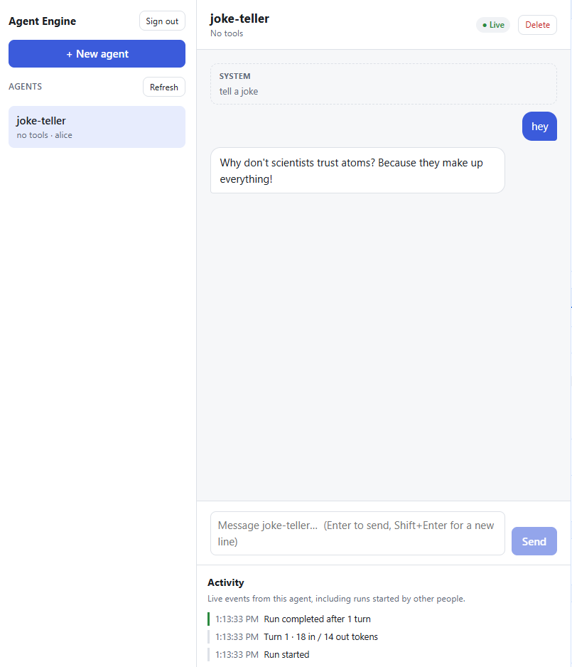

# Agent Engine

A small, security-minded engine for running tool-using AI agents over HTTP, with a web UI. Create
agents at runtime, chat with them, and watch every run live. Models run locally through
[Ollama](https://ollama.com), so nothing leaves your machine.



## Features

- **Agents at runtime:** create, list, prompt and delete agents over a REST API. Each agent has a
  system prompt, a set of tools and its own conversation history.
- **Live activity:** a Server-Sent Events stream for each agent reports runs, turns, tool calls and
  results as they happen.
- **Access control throughout:** API keys map to users and roles, and every route requires a
  permission. Agents are private to their owner. The model only sees tools the caller may use.
- **Guardrails no route can bypass:** a master policy sets input and output size limits, rate limits,
  output field redaction, and per-run caps on turns, tokens and time.
- **Tamper-evident request log:** a per-user hash chain links every request (`X-Request-Hash`).
- **Pluggable models:** Ollama (default), an offline simulated model for tests, and an Anthropic
  provider package.

## Quick start (Podman)

Requires [Podman](https://podman.io) with `podman compose`.

```bash
# 1. Model server, plus a small model (~400 MB, runs on CPU)
podman volume create ollama        # once
podman compose --profile ollama up -d ollama
podman exec agent-engine_ollama_1 ollama pull qwen2.5:0.5b

# 2. API server (:3000) and web UI (:8080)
podman compose up --build -d
```

Open **http://localhost:8080** and sign in with `dev-admin-key`. `dev-viewer-key` is a limited user
that can't create agents.

Stop everything with `podman compose --profile ollama down`. Downloaded models stay in the `ollama`
volume.

More on the model server, including model choices, GPUs and troubleshooting:
[docs/ollama-podman.md](docs/ollama-podman.md).

## Configuration

Set these in `.env` next to `compose.yaml` (see [`.env.example`](.env.example)). `.env` is ignored by
git and the container build.

| Variable | Default | Meaning |
|---|---|---|
| `API_KEYS` | `dev-admin-key=alice:admin;dev-viewer-key=bob:viewer` | `key=userId:role1,role2;...`. **Set real keys before sharing the server.** |
| `MODEL` | `ollama` | `ollama`, or `simulated` for an offline stub with no model server |
| `OLLAMA_URL` | `http://169.254.1.2:11434` | Ollama address as seen from the engine container (pasta maps `169.254.1.2` to the host) |
| `OLLAMA_MODEL` | `qwen2.5:0.5b` | Any model you've pulled. `qwen3:1.7b` is noticeably smarter and still quick. |
| `OLLAMA_NUM_CTX` | server default | Context window in tokens |

Roles: **admin** (everything, including other users' agents), **builder** (create, run and delete their
own agents; all tools), and **viewer** (list and run their own agents, but can't create or delete
them; time tool only).

## API

All routes need `Authorization: Bearer <key>`. JSON bodies are strict, so unknown fields are rejected.

| Method | Path | Body | Permission |
|---|---|---|---|
| `POST` | `/services/agents` | `{name, system?, tools?, model?, effort?}` | `agents:create` |
| `GET` | `/services/agents` | | `agents:read` |
| `GET` | `/services/agents/tools` | | `agents:read` |
| `GET` | `/services/agents/:id` | | `agents:read` |
| `DELETE` | `/services/agents/:id` | | `agents:delete` |
| `POST` | `/services/agents/:id/messages` | `{prompt}` | `agents:run` |
| `GET` | `/services/agents/:id/messages` | | `agents:read` |
| `GET` | `/services/agents/:id/events` | (SSE stream) | `agents:read` |

```bash
A='Authorization: Bearer dev-admin-key'; J='Content-Type: application/json'
curl -s -X POST -H "$A" -H "$J" -d '{"name":"math","tools":["add"]}' localhost:3000/services/agents
curl -s -X POST -H "$A" -H "$J" -d '{"prompt":"What is 17 plus 25?"}' localhost:3000/services/agents/<id>/messages
curl -sN -H "$A" localhost:3000/services/agents/<id>/events      # live events
```

On Windows PowerShell, use `curl.exe`; plain `curl` there is an alias for `Invoke-WebRequest`.

## Repository layout

| Path | What it is |
|---|---|
| `packages/engine` (`@agent-engine/core`) | The engine: router, middleware pipeline (auth, limits, hash chain), agent runner, agent service |
| `packages/provider-ollama` | Ollama `ModelProvider` (native `/api/chat`, tool calling) |
| `packages/provider-anthropic` | Anthropic `ModelProvider` (not used by the server) |
| `apps/server` | The API server: wires the engine, tools, keys and model from environment variables |
| `apps/ui` | React + Vite web UI, and a dependency-free production server that proxies `/services` |
| `Containerfile`, `compose.yaml` | Images for `engine` and `ui`, plus the opt-in `ollama` service |

## Development

Requires Node.js 24+ and pnpm 11.

```bash
pnpm install
pnpm typecheck
pnpm test
API_KEYS='dev-admin-key=alice:admin' OLLAMA_URL=http://localhost:11434 pnpm server   # API on :3000
pnpm ui                                                                              # UI on :5173
```

Use `MODEL=simulated` to run the server without Ollama.
